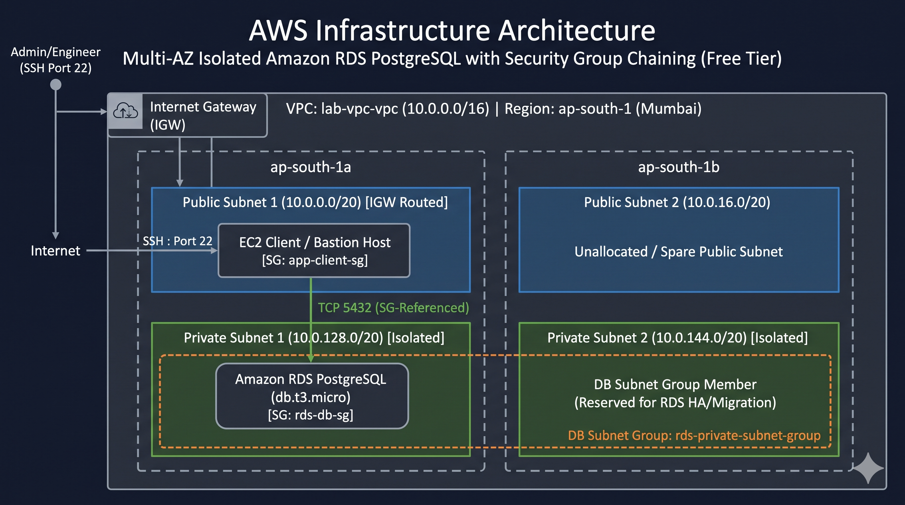

# Secure Multi-AZ Private Amazon RDS Deployment (AWS Free Tier)

A secure, cost-optimized deployment of Amazon RDS PostgreSQL inside a custom dual-Availability Zone Virtual Private Cloud (VPC). This project implements the **Principle of Least Privilege**, complete network isolation for data persistence, and strict adherence to the **AWS Free Tier** limits to maintain zero infrastructure cost.

---

## Architecture Overview



```text
AWS Cloud: Asia Pacific (Mumbai) / ap-south-1
VPC: lab-vpc-vpc (10.0.0.0/16)
│
├── Internet Gateway (lab-vpc-igw)
│   └── Public Route Table (0.0.0.0/0 -> igw)
│
├── Availability Zone: ap-south-1a
│   ├── Public Subnet (10.0.0.0/20)    ── Routes to Internet Gateway
│   └── Private Subnet (10.0.128.0/20) ── Isolated (Local VPC routes only)
│
└── Availability Zone: ap-south-1b
    ├── Public Subnet (10.0.16.0/20)   ── Routes to Internet Gateway
    └── Private Subnet (10.0.144.0/20) ── Isolated (Local VPC routes only)

========================================================================================
Traffic Authorization (Security Group Chaining):
[Client/Bastion SG] (app-client-sg) ──> Inbound TCP 5432 ──> [RDS Database SG] (rds-db-sg)
========================================================================================
